# DeskHog: A developer toy for sparking developer joy


## Dive in

Ready to put your kit together? [Start here.](/getting-started/start-here.md)

## What is DeskHog?
DeskHog is an open-source, 3D printed, palm-sized developer toy. 

It's a toy to tinker with, adapt, and to get curious with. We'll be folding in a library of simple example games and apps, including a pomodoro timer and versions of Pong, Rogue, Flappy Bird. You can see PRs for these in this repo now for inspiration!

We think that sounds like fun and, if you do too, then DeskHog is for you. 

## OK, but what is it?

DeskHog packs an Adafruit ESP32-S3 Reverse TFT Feather in a custom-made 3D printed case. It comes complete with a 240x135 color TFT display, a 10-hour battery life, WiFi, and a cute little LED so you can find it in the dark.

A [plug-and-play DeskHog hardware kit](https://posthog.com/merch) is coming soon (so you can get everything in one box). In the meantime, here’s what you’ll need if you want to make DeskHog yourself right now. 

- ESP32-S3 Reverse TFT Feather – [`Adafruit 5691`](https://learn.adafruit.com/esp32-s3-reverse-tft-feather) – buy: [Adafruit](https://www.adafruit.com/product/5691), [DigiKey](https://www.digikey.com/en/products/detail/adafruit-industries-llc/5691/18627502?s=N4IgjCBcoLQBxVAYygMwIYBsDOBTANCAPZQDa4ArAEwIC6AvvYVWSBQGwCcEDQA), [Mouser](https://www.mouser.com/ProductDetail/Adafruit/5691?qs=mELouGlnn3eeALy2e3r3sw%3D%3D), [Botland (EU)](https://botland.store/arduino-compatible-boards-adafruit/22891-feather-esp32-s3-reverse-with-tft-display-wifi-module-4mb-flash-2mb-psram-compatible-with-arduino-adafruit-5691.html), [The Pi Hut (UK)](https://thepihut.com/products/adafruit-esp32-s3-reverse-tft-feather-4mb-flash-2mb-psram-stemma-qt), [Electromaker](https://www.electromaker.io/shop/product/adafruit-esp32-s3-reverse-tft-feather-4mb-flash-2mb-psram-stemma-qt?srsltid=AfmBOorFfshQCLVi9EDKfmKFKMNC_cE3Ww0NaY0U0evm5ZU2OEM2Yn_B), [BerryBase (EU)](https://www.berrybase.de/en/adafruit-esp32-s3-reverse-tft-feather)
- Optional: PKCell 552035 350mAh 3.7V LiPoly battery – buy: [Adafruit](https://www.adafruit.com/product/2750), [Tinytronics (EU)](https://www.tinytronics.nl/en/power/batteries/li-po/pkcell-li-po-battery-3.7v-350mah-jst-ph-lp552035), [BerryBase (EU)](https://www.berrybase.de/en/lp-552035-lithium-polymer-lipo-akku-3-7v-350mah-mit-2-pin-jst-stecker)
- 3D printed enclosure – print: [3mf file](3d-printing)

## Plugins

DeskHog runs plugins: small Lua files that show up as cards. You install them over WiFi from the device's web page or the command line, with no recompiling and no reflashing.

The web page has a plugin directory, with a picture of every card: it is the Plugins page, and what it offers is also among the choices when you add a card. Pick what you want and it is installed. The directory is the [`plugins/`](plugins) folder of this repository on GitHub, so adding a plugin for everyone is a pull request, and you can point a device at a directory of your own. A freshly flashed device starts empty; the firmware carries no plugins unless you list some in `plugins/bundled.txt`.

```lua
plugin = { name = "Counter" }

local count = 0

function draw()
  ui.title("Counter")
  ui.big(tostring(count))
end

function button(name)
  if name == "center" then
    count = count + 1
    return true
  end
end
```

```sh
tools/sim/run.sh counter.lua       # try it on your computer, saves a screenshot
tools/deskhog push counter.lua     # put it on the device
tools/deskhog watch counter.lua    # push again on every save
```

Plugins can fetch JSON from any API, draw freely, react to the three buttons, set the LED and keep small bits of data. A plugin that crashes shows its error on its own card and leaves the rest of the device alone.

One plugin can provide several cards that share settings, such as one account with a card per chart. The device's web page (open `http://deskhog.local`) is where you add, arrange and set up cards. It shows a live picture of each one, and the device's three buttons work from the page, so you can try a card without reaching for the device. On a computer it has a wide layout with an editor for plugin code.

[**Read the plugin guide**](plugins/README.md) to write your own.

### The plugins

These are in [`plugins/`](plugins), which is also the plugin directory: on the device's web page, Get plugins shows them all, and Add card offers them too. None is built into the firmware.

<!-- plugin-list:start (written by `tools/deskhog index`; do not edit by hand) -->
<table>
<tr>
<td width="33%" valign="top"><a href="plugins/blocks.lua">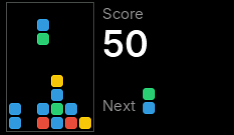</a><br><b><a href="plugins/blocks.lua">Blocks</a></b><br>Falling pairs of colours: bring three together and they are gone</td>
<td width="33%" valign="top"><a href="plugins/breakout.lua">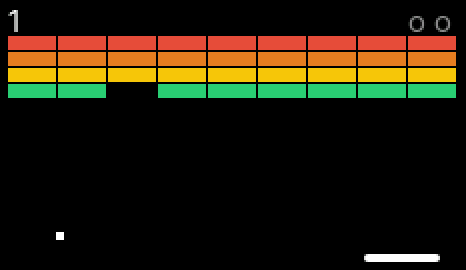</a><br><b><a href="plugins/breakout.lua">Breakout</a></b><br>A bat, a ball and a wall of bricks. Three lives</td>
<td width="33%" valign="top"><a href="plugins/clock.lua">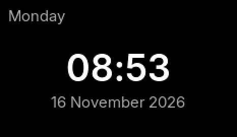</a><br><b><a href="plugins/clock.lua">Clock</a></b><br>The time in large digits, with the date under it</td>
</tr>
<tr>
<td width="33%" valign="top"><a href="plugins/countdown.lua">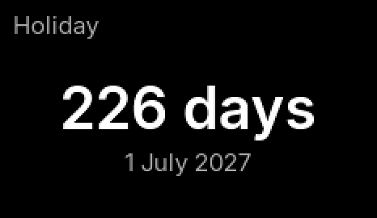</a><br><b><a href="plugins/countdown.lua">Countdown</a></b><br>How long until the launch, the holiday, the birthday. A card per date</td>
<td width="33%" valign="top"><a href="plugins/crypto.lua">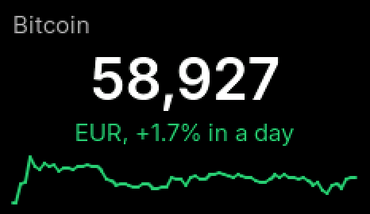</a><br><b><a href="plugins/crypto.lua">Crypto prices</a></b><br>The price of a coin, how it moved today, and the last 24 hours as a chart</td>
<td width="33%" valign="top"><a href="plugins/joke.lua"></a><br><b><a href="plugins/joke.lua">Dad jokes</a></b><br>A new dad joke every half hour, or whenever you press the button</td>
</tr>
<tr>
<td width="33%" valign="top"><a href="plugins/deploy.lua"></a><br><b><a href="plugins/deploy.lua">Deploy button</a></b><br>Press, confirm, and your deploy hook is called. Shows whether it worked and when it last ran</td>
<td width="33%" valign="top"><a href="plugins/flappy.lua"></a><br><b><a href="plugins/flappy.lua">Flappy Hog</a></b><br>One button. Endless frustration. Infinite glory.</td>
<td width="33%" valign="top"><a href="plugins/github.lua">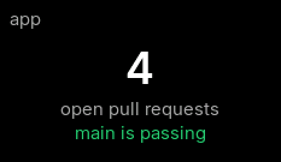</a><br><b><a href="plugins/github.lua">GitHub</a></b><br>Open pull requests and whether the build passes, per repository. Red LED on failure</td>
</tr>
<tr>
<td width="33%" valign="top"><a href="plugins/hello.lua">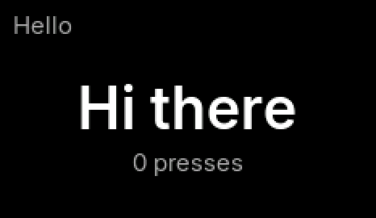</a><br><b><a href="plugins/hello.lua">Hello</a></b><br>The smallest useful plugin: three lines of text and a press counter</td>
<td width="33%" valign="top"><a href="plugins/runner.lua">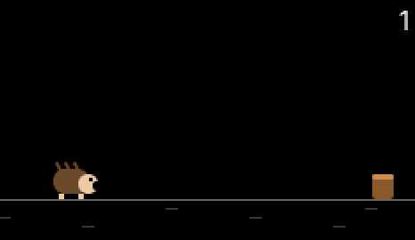</a><br><b><a href="plugins/runner.lua">Hog run</a></b><br>An endless run: jump the logs, roll under the bees</td>
<td width="33%" valign="top"><a href="plugins/homeassistant.lua"></a><br><b><a href="plugins/homeassistant.lua">Home Assistant</a></b><br>A card per entity: its state, and a button to toggle it or run a script or scene</td>
</tr>
<tr>
<td width="33%" valign="top"><a href="plugins/homey.lua"></a><br><b><a href="plugins/homey.lua">Homey</a></b><br>A card per Homey Pro device: one of its values, and a button that starts a flow</td>
<td width="33%" valign="top"><a href="plugins/lander.lua"></a><br><b><a href="plugins/lander.lua">Lander</a></b><br>Three thrusters, a little fuel and a landing pad that keeps shrinking</td>
<td width="33%" valign="top"><a href="plugins/friend.lua">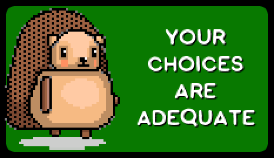</a><br><b><a href="plugins/friend.lua">Max</a></b><br>Max the hedgehog keeps you company and thinks you are doing fine</td>
</tr>
<tr>
<td width="33%" valign="top"><a href="plugins/paddle.lua"></a><br><b><a href="plugins/paddle.lua">Paddle</a></b><br>First to five points beats the hedgehog on the other side</td>
<td width="33%" valign="top"><a href="plugins/pet.lua"></a><br><b><a href="plugins/pet.lua">Pet hedgehog</a></b><br>A hedgehog that gets hungry and bored, sleeps at night and likes a pat</td>
<td width="33%" valign="top"><a href="plugins/pomodoro.lua">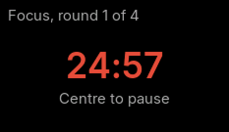</a><br><b><a href="plugins/pomodoro.lua">Pomodoro</a></b><br>Focus for 25 minutes, take a break, repeat. The LED shows which it is</td>
</tr>
<tr>
<td width="33%" valign="top"><a href="plugins/posthog.lua">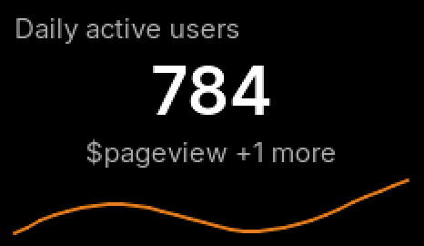</a><br><b><a href="plugins/posthog.lua">PostHog</a></b><br>PostHog insights on your desk: big numbers, line charts and funnels</td>
<td width="33%" valign="top"><a href="plugins/question.lua"></a><br><b><a href="plugins/question.lua">Questions</a></b><br>Icebreaker questions for the minutes before a meeting starts</td>
<td width="33%" valign="top"><a href="plugins/rain.lua"></a><br><b><a href="plugins/rain.lua">Rain</a></b><br>Whether it will rain in the next two hours, where you are, quarter by quarter</td>
</tr>
<tr>
<td width="33%" valign="top"><a href="plugins/reaction.lua">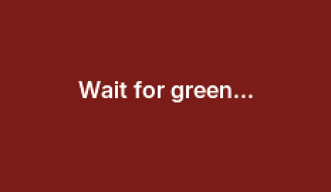</a><br><b><a href="plugins/reaction.lua">Reaction timer</a></b><br>Wait for green, then press. How many milliseconds did you need?</td>
<td width="33%" valign="top"><a href="plugins/rps.lua">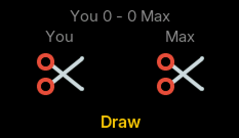</a><br><b><a href="plugins/rps.lua">Rock paper scissors</a></b><br>One button per hand. First to three beats the hedgehog</td>
<td width="33%" valign="top"><a href="plugins/simon.lua"></a><br><b><a href="plugins/simon.lua">Simon</a></b><br>Watch the pattern, repeat the pattern. It gets longer every round</td>
</tr>
<tr>
<td width="33%" valign="top"><a href="plugins/snake.lua"></a><br><b><a href="plugins/snake.lua">Snake</a></b><br>Two buttons to steer, one to pause. Eat, grow, don&#x27;t bite yourself</td>
<td width="33%" valign="top"><a href="plugins/space.lua"></a><br><b><a href="plugins/space.lua">Space</a></b><br>How far away the space station is right now, and a countdown to the next rocket launch</td>
<td width="33%" valign="top"><a href="plugins/starfield.lua"></a><br><b><a href="plugins/starfield.lua">Starfield</a></b><br>Stars flying past, for when the desk needs to look busy</td>
</tr>
<tr>
<td width="33%" valign="top"><a href="plugins/queues.lua"></a><br><b><a href="plugins/queues.lua">Theme park queues</a></b><br>The longest waits in a theme park right now, or the rides you care about</td>
<td width="33%" valign="top"><a href="plugins/trains.lua"></a><br><b><a href="plugins/trains.lua">Trains (Belgium)</a></b><br>The next departures from a Belgian station, with delays and platforms</td>
<td width="33%" valign="top"><a href="plugins/trivia.lua">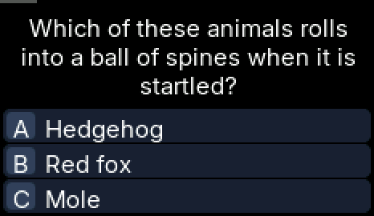</a><br><b><a href="plugins/trivia.lua">Trivia</a></b><br>Ten questions, three answers, one button each. From the Open Trivia Database</td>
</tr>
<tr>
<td width="33%" valign="top"><a href="plugins/uptime.lua"></a><br><b><a href="plugins/uptime.lua">Uptime</a></b><br>Checks up to five web addresses every two minutes. Red LED when one is down</td>
<td width="33%" valign="top"><a href="plugins/weather.lua"></a><br><b><a href="plugins/weather.lua">Weather</a></b><br>The temperature now and today&#x27;s curve, for any number of cities</td>
<td width="33%" valign="top"><a href="plugins/webhook.lua"></a><br><b><a href="plugins/webhook.lua">Webhook</a></b><br>A button that calls a web address and lights the LED</td>
</tr>
<tr>
<td width="33%" valign="top"><a href="plugins/whack.lua"></a><br><b><a href="plugins/whack.lua">Whack-a-hog</a></b><br>Three burrows, three buttons. Bonk the hedgehog before it ducks</td>
</tr>
</table>
<!-- plugin-list:end -->

Every card is a plugin. The cards that used to be compiled into the firmware (Max, the question card, Flappy Hog, Paddle, hello world) are Lua files now, which you can read and change on the device's web page. Only the WiFi and status screen is still part of the firmware.

### Moving from an older firmware

This firmware uses a different flash layout: one firmware slot plus about 1 MB of storage for plugins, where older versions had two firmware slots for over-the-air updates. Because of that:

- **The first install has to go over USB.** In PlatformIO, choose **Upload** as usual. WiFi and card settings carry over. (Older firmware lost the newest settings on every USB upload, because one boot file was written into the settings area. That is fixed here; see `fix_otadata_offset.py`.)
- **Firmware updates are over USB from now on.** Plugins are what updates over WiFi.
- The first boot takes a few seconds longer while the plugin storage is set up.

## What can DeskHog do?

DeskHog can do a couple of things by default, but the real joy lies in expanding the capabilities by adding them yourself. 

### Out of the box functionality

A couple of basic [cards](#card-stack) (screens) are included on the firmware and were built by [Danilo Campos](https://posthog.com/community/profiles/31731).

- **ProvisioningCard**: Displays a QR code to connect to the device and shows connection stats.
- **PostHog insights**: big numbers, line charts and funnels from your PostHog project. This is a plugin now ([`plugins/posthog.lua`](plugins/posthog.lua)): add a card on the device's web page and fill in your project ID and a personal API key. Insight cards set up with older firmware are kept on the first boot, with their settings; install the PostHog plugin from the web page and they work again.
- **Max**: Max the hedgehog visits and provides encouragement. A plugin too ([`plugins/friend.lua`](plugins/friend.lua)); you can give him your own lines.
- **Questions**, **Flappy Hog**, **Paddle**: icebreaker questions and two games, also plugins. Cards of these kinds set up with older firmware are kept on the first boot; the web page offers to install the plugin each one needs.

### Available games and apps

We're working on adding some of the following games to an `/examples` folder which will include a selection of games and apps for you to play with. If you can't see them in the `/examples` folder it's probably because they exist as [unapproved PRs](https://github.com/PostHog/DeskHog/pulls) while we work on them. No problem, just checkout the branch!

Example games include:

- **Pog**: A Pong clone by [Leon Daly](https://posthog.com/community/profiles/30833)
- **IdleHog**: An idle clicker by [Chris McNeill](https://posthog.com/community/profiles/33534)
- **One Button Dungeon**: An idle Roguelike by [Joe Martin](https://posthog.com/community/profiles/29070)
- **Dictator or Techbro: DeskHog Edition**: A quiz game by [Chris McNeill](https://posthog.com/community/profiles/33534)
- **Notchagotchi**: A virtual pet by [Sophie Payne](https://posthog.com/community/profiles/33385)
- **Flappy Hog**: A Flappy Bird clone by [Joe Martin](https://posthog.com/community/profiles/29070)
- **Hog Speed**: A reaction game by [Chris McNeill](https://posthog.com/community/profiles/33534)
- **Pineapple Reflex**: A pizza-based game by [Sophie Payne](https://posthog.com/community/profiles/33385)
- **Three Button Dungeon**: An Ultima-like by [Joe Martin](https://posthog.com/community/profiles/29070)

Example apps include:

- **Awkwardness Avoider**: A smalltalk prompter by [Annika Schmid](https://posthog.com/community/profiles/28619)
- **Pomodoro**: A productivity timer by [Annika Schmid](https://posthog.com/community/profiles/28619)

All of the example apps were built in 24 hours at [a PostHog hackathon](https://posthog.com/handbook/company/offsites) by people who hadn't coded before at all. These example cards are a testament to [what's possible when vibe coding on DeskHog](#-vibe-coding-with-ai-agents), but some lack polish - so make sure you know [how to reset DeskHog](#buttons-and-reset-sequences). Just in case.

## Developing for DeskHog

Review [tech-details.md](tech-details.md) for info on architecture, libraries and key components used in this project.

## Troubleshooting

### No matter what I do, flashing the board doesn't change anything! wtf??

The board can end up booting from the wrong place, for example after switching between this firmware and an older one with a different flash layout.

To fix this, choose **Erase Flash and Upload** from the PlatformIO Project Tasks menu. This also erases your WiFi settings, cards and plugins.

## 🤖 Coding with AI Agents

> DeskHog is optimized for agent development. If you've never tried coding with AI before, here's [a guide to get you started](https://posthog.com/tutorials/deskhog-claude-tutorial)!

We couldn't have built DeskHog without the help of agent development workflows, and we encourage agent-driven development with a few caveats.

LLMs often struggle with multi-threaded embedded systems. DeskHog’s firmware has strict rules for core/task roles; AI might overlook them unless you guide it.

If you're looking to [get started](https://posthog.com/tutorials/deskhog-claude-tutorial), we recommend using [Claude Code](https://www.anthropic.com/claude-code) with [Visual Studio Code](https://code.visualstudio.com/) and the [PlatformIO extension](https://platformio.org/install/ide?install=vscode). They work well together and you can build all sorts of things with natural language.

Use `tech-details.md` to give your agent broad context on the device. Still, even with that you should bear in mind the following advice:

- You should encourage AI to follow existing patterns: use`EventQueue` for cross-core messaging and update the UI only on the UI task.
- Flag any AI suggestions that touch the UI from the wrong core.
- Review and test thoroughly—watch for “LLM slop” (unused vars, odd delays) and clean it up.

Think of your AI as a speedy junior dev: brilliant but prone to mistakes. You’re the senior dev keeping it on track. With that balance, AI can boost productivity while keeping DeskHog reliable.

## Power off

If you want to turn the device off, hold ● + ▼ for two seconds. The device will enter deep sleep mode. 

To wake the device, press the reset tab on the left. 

## UI progress
- Status card: working
- WiFi provisioning card with QR Code: working
- Friend card to give you (mild) reassurance: working
- PostHog big numbers, line charts and funnels: working, as a plugin
- Other kinds of PostHog insight: not yet supported

## Request for PRs

The following PRs would be interesting, and may earn you a free DeskHog kit or other merch:

- More kinds of insight in the PostHog plugin (`plugins/posthog.lua`)
- More games and apps! We think limiting things to one available button prompts creativity
- Support for other boards and displays
- LLM slop mitigation: if you see anything obviously stupid in this code that hasn't yet been caught and cleaned up
- DX improvements around task isolation: if your experience with embedded code says there's a better way to architect this, happy to follow your lead
- Improved C++: not my preferred language, feel free to suggest idiomatic and architectural improvements
- Desk utilities, like a pomodoro timer; also constrained: center button only. Be creative!
- PlatformIO config improvements: flashing builds causes a reboot that seems unnecessary, maybe you know a better configuration

## Forks

This firmware has a simple goal: make it easy to set up a stack of screens that you can page through easily, managed by a web UI. But this is just one way to use the power of the board we chose. Feel free to steal this code, keep what helps, throw out what you don't like, and try something totally different. If you get somewhere interesting with your fork, let us know with a pull request to edit this section!

### Community Forks
- **[joshlevitre/DeskHog](https://github.com/joshlevitre/DeskHog)** - Adds a Pokedex card that fetches and displays random Pokemon from the PokeAPI

## Feedback

PRs over issues, but if you've got any trouble, feel free to open an issue. You can also contact the maintainer, danilo@posthog.com.
