# DeskHog: a developer toy for sparking developer joy


DeskHog is an open-source, 3D printed, palm-sized desk gadget: a small colour screen, three buttons, WiFi, a battery and an LED. It shows a stack of cards that you page through with the buttons.

This is a fork of [PostHog/DeskHog](https://github.com/PostHog/DeskHog) in which **every card is a plugin**: a small Lua file that you install over WiFi from the device's own web page, without recompiling or reflashing. There are more than thirty to pick from, and writing your own takes a few lines.

- [What's new in 0.4.0](#whats-new-in-040) and [in 0.3.0](#whats-new-in-030)
- [What you need](#what-you-need)
- [Install](#install) and [set it up](#set-it-up)
- [Plugins](#plugins), with [all of them in pictures](#the-plugins)
- [Using the device](#using-the-device)
- [Moving from PostHog's firmware](#moving-from-posthogs-firmware)
- [Working on DeskHog](#working-on-deskhog)
- [Troubleshooting](#troubleshooting)

## What's new in 0.4.0

New things for plugins to do, and nine plugins that show them off:

- **Local time.** Set the device's time zone once on the web page (Device). Clocks, countdowns and reminders follow summer time without a setting of their own.
- **Cards that ask for attention.** A plugin can bring its card to the front with a short message, for a finished timer or a failed build. Each card has a "May come to the front" setting, and a game that is being played is never interrupted.
- **Messages from outside.** Send text to a card from a script, a webhook or `tools/deskhog send`, instead of the card polling for it.
- **Checked certificates.** HTTPS requests now check the server's certificate, and redirects are followed.
- **More for plugins:** any HTTP method and the response headers, timers that keep running while a card is hidden, long presses, arcs and shapes, a tiny font, pictures from the web, the WiFi signal, and settings with a list to choose from. See [plugins/README.md](plugins/README.md).
- **New plugins:** World clock, Reminders, Doorbell, CI watch (GitHub Actions), Now playing (Last.fm, with the cover), Gauge, WiFi, and Charge, a game. Homey switches devices and lets you pick them from a list.

Plugins that use any of this need firmware 0.4.0: update the firmware before you update Clock or Countdown.

## What's new in 0.3.0

Compared with PostHog's firmware, 0.2.0 and earlier:

- **Every card is a plugin.** A plugin is a Lua file that is installed over WiFi and runs in a sandbox: a crash shows on its own card and nothing else stops. Adding a card no longer means compiling firmware.
- **A plugin directory with 34 plugins**, each with a picture: games, clocks and timers, weather, trains, GitHub, Home Assistant, Homey Pro, PostHog and more. The web page offers updates when a plugin you have changes.
- **A new web page**, made for a computer as well as a phone: a live picture of every card, the device's buttons on the page, drag to reorder, and an editor for plugin code.
- **Connections.** One plugin can provide several cards that share settings, and you can connect the same service twice, for example two PostHog projects.
- **Install from a browser.** Releases come with a firmware file that a web flasher writes to the board; no toolchain needed.
- **Tools for writing plugins:** a simulator that runs a plugin on your computer and saves a picture, and a command line tool that pushes to the device on every save.
- **Fixed:** WiFi and card settings were lost after a USB upload; the display was touched from the WiFi task, which could crash; the saved network was not tried again once the device had fallen back to setup mode.

What you give up:

- **Firmware updates over the air.** The space of the second firmware slot now holds the plugins, so the firmware is updated over USB. See [tech-details.md](tech-details.md#flash-layout) for the ways back.
- **Cards compiled into the firmware.** PostHog insights, Max, the question card, Flappy Hog and Paddle are plugins now. Cards you had are kept; see [Moving from PostHog's firmware](#moving-from-posthogs-firmware).

## What you need

DeskHog is an Adafruit ESP32-S3 Reverse TFT Feather in a 3D printed case: a 240x135 colour display, WiFi, three buttons and an LED, with room for a battery.

- ESP32-S3 Reverse TFT Feather – [`Adafruit 5691`](https://learn.adafruit.com/esp32-s3-reverse-tft-feather) – buy: [Adafruit](https://www.adafruit.com/product/5691), [DigiKey](https://www.digikey.com/en/products/detail/adafruit-industries-llc/5691/18627502?s=N4IgjCBcoLQBxVAYygMwIYBsDOBTANCAPZQDa4ArAEwIC6AvvYVWSBQGwCcEDQA), [Mouser](https://www.mouser.com/ProductDetail/Adafruit/5691?qs=mELouGlnn3eeALy2e3r3sw%3D%3D), [Botland (EU)](https://botland.store/arduino-compatible-boards-adafruit/22891-feather-esp32-s3-reverse-with-tft-display-wifi-module-4mb-flash-2mb-psram-compatible-with-arduino-adafruit-5691.html), [The Pi Hut (UK)](https://thepihut.com/products/adafruit-esp32-s3-reverse-tft-feather-4mb-flash-2mb-psram-stemma-qt), [Electromaker](https://www.electromaker.io/shop/product/adafruit-esp32-s3-reverse-tft-feather-4mb-flash-2mb-psram-stemma-qt?srsltid=AfmBOorFfshQCLVi9EDKfmKFKMNC_cE3Ww0NaY0U0evm5ZU2OEM2Yn_B), [BerryBase (EU)](https://www.berrybase.de/en/adafruit-esp32-s3-reverse-tft-feather)
- Optional: PKCell 552035 350mAh 3.7V LiPoly battery – buy: [Adafruit](https://www.adafruit.com/product/2750), [Tinytronics (EU)](https://www.tinytronics.nl/en/power/batteries/li-po/pkcell-li-po-battery-3.7v-350mah-jst-ph-lp552035), [BerryBase (EU)](https://www.berrybase.de/en/lp-552035-lithium-polymer-lipo-akku-3-7v-350mah-mit-2-pin-jst-stecker)
- 3D printed enclosure – print: [3mf file and printing notes](3d-printing)

The board works without the case and without the battery, on USB power. For putting a kit together, see [getting started](getting-started/start-here.md).

## Install

### From your browser

You need a computer with Chrome or Edge, and a USB cable that carries data.

1. Download `deskhog-<version>-full.bin` from the [latest release](https://github.com/TimBroddin/DeskHog/releases/latest).
2. Connect the board and put it in bootloader mode: hold ▼, press the reset tab on the left, release ▼.
3. Open the [Adafruit WebSerial ESPTool](https://adafruit.github.io/Adafruit_WebSerial_ESPTool/), press **Connect** and choose the board from the list (it is called something like "USB JTAG/serial debug unit").
4. In the first row, leave the offset at `0x0`, choose the file you downloaded, and press **Program**.
5. When it says it is done, press the reset tab. The screen shows a QR code: carry on with [Set it up](#set-it-up).

This is a fresh start: the board forgets its WiFi network and its cards. (Plugins that were installed stay; press **Erase** before Program for a completely empty board.) To keep everything on a board that already runs this firmware, see [Updating](#updating). [Espressif's web flasher](https://espressif.github.io/esptool-js/) does the same job, with the same file and "Flash Address" `0x0`.

### From source

Open this folder in [Visual Studio Code](https://code.visualstudio.com/) with the [PlatformIO extension](https://platformio.org/install/ide?install=vscode) and choose **Upload**, or run `pio run -t upload` from a terminal. Installed this way, a board that comes from PostHog's firmware keeps its WiFi and cards; see [below](#moving-from-posthogs-firmware).

### Updating

Plugins update over WiFi: when the directory has a newer version of one you have, the web page offers it.

For new firmware, the device's web page (Device, About) says which version it runs and links to the latest release. Take `deskhog-<version>-update.bin` from it and follow the steps above with one difference: the offset is `0x20000` instead of `0x0`. WiFi, cards and plugins stay as they are. From source, **Upload** does the same.

## Set it up

1. **Connect it to WiFi.** The screen shows a QR code. Scan it with your phone, or join the network named under it (`DeskHog_…`) from a computer. The device's web page opens; pick your network and give its password.
2. **Open the web page again**, now on your own network: `http://deskhog.local`, or the address on the device's status card (the first card in the stack).
3. **Add cards.** Press **Add card** and choose what it should show. A freshly installed device has no plugins yet, so the choices come from the plugin directory: choosing one installs its plugin and adds the card. **Get plugins** shows everything there is.

The web page is also where you rearrange and remove cards, change their settings and manage accounts that several cards share (Connections). It shows a live picture of each card, and the device's three buttons work from the page, so you can try a card without reaching for the device.

## Plugins

A plugin is one Lua file. It can fetch JSON from any API, draw freely, react to the three buttons, set the LED and keep small bits of data. A plugin that crashes shows its error on its own card and leaves the rest of the device alone.

```lua
plugin = { name = "Counter" }

local count = 0

function draw()
  ui.title("Counter")
  ui.big(tostring(count))
end

function button(name)
  if name == "center" then
    count = count + 1
    return true
  end
end
```

```sh
tools/sim/run.sh counter.lua       # try it on your computer, saves a screenshot
tools/deskhog push counter.lua     # put it on the device
tools/deskhog watch counter.lua    # push again on every save
```

One plugin can provide several cards that share settings, such as one account with a card per chart. On a computer, the web page has an editor for plugin code, so you can also write and change plugins right on the device.

[**Read the plugin guide**](plugins/README.md) to write your own. It covers the whole API, the simulator, the command line tool and how to publish a plugin.

### The plugin directory

Plugins come from a plugin directory: a folder of plugins with a list of them, in a git repository. The [`plugins/`](plugins) folder of this repository is one, and it is the one a device uses unless you tell it otherwise. So adding a plugin for everyone is a pull request, and you can point a device at a directory of your own: on the Plugins page, choose Change next to the directory's name.

The device itself never fetches plugins. The web page (or `tools/deskhog install`) downloads the file and hands it to the device. After a change to the directory it can take a few minutes before every device's page sees it, because GitHub serves the files from a cache.

The firmware carries no plugins. If a batch of devices has to show something on first boot without internet, list plugin names in [`plugins/bundled.txt`](plugins/bundled.txt) before building.

### The plugins

These are in the directory now. On the device's web page, Get plugins shows them all, and Add card offers them too.

<!-- plugin-list:start (written by `tools/deskhog index`; do not edit by hand) -->
<table>
<tr>
<td width="33%" valign="top"><a href="plugins/air.lua">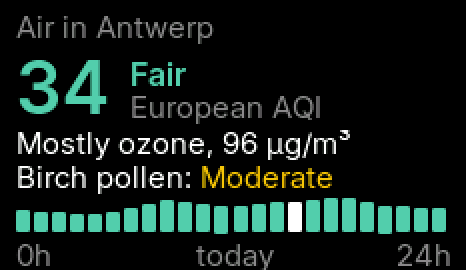</a><br><b><a href="plugins/air.lua">Air</a></b><br>Air quality and pollen where you are, with a bar per hour of today</td>
<td width="33%" valign="top"><a href="plugins/blocks.lua"></a><br><b><a href="plugins/blocks.lua">Blocks</a></b><br>Falling pairs of colours: bring three together and they are gone</td>
<td width="33%" valign="top"><a href="plugins/breakout.lua"></a><br><b><a href="plugins/breakout.lua">Breakout</a></b><br>A bat, a ball and a wall of bricks. Three lives</td>
</tr>
<tr>
<td width="33%" valign="top"><a href="plugins/charge.lua">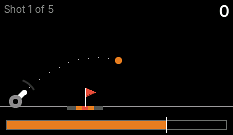</a><br><b><a href="plugins/charge.lua">Charge</a></b><br>Hold to charge, let go to fire: five acorns, a flag that moves and a wall in the way</td>
<td width="33%" valign="top"><a href="plugins/ciwatch.lua">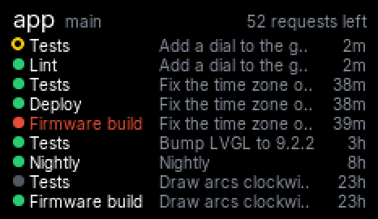</a><br><b><a href="plugins/ciwatch.lua">CI watch</a></b><br>The latest GitHub Actions runs of a repository, with a nudge when one goes red</td>
<td width="33%" valign="top"><a href="plugins/clock.lua"></a><br><b><a href="plugins/clock.lua">Clock</a></b><br>The time in large digits, with the date under it</td>
</tr>
<tr>
<td width="33%" valign="top"><a href="plugins/countdown.lua"></a><br><b><a href="plugins/countdown.lua">Countdown</a></b><br>How long until the launch, the holiday, the birthday. A card per date</td>
<td width="33%" valign="top"><a href="plugins/crypto.lua"></a><br><b><a href="plugins/crypto.lua">Crypto prices</a></b><br>The price of a coin, how it moved today, and the last 24 hours as a chart</td>
<td width="33%" valign="top"><a href="plugins/joke.lua"></a><br><b><a href="plugins/joke.lua">Dad jokes</a></b><br>A new dad joke every half hour, or whenever you press the button</td>
</tr>
<tr>
<td width="33%" valign="top"><a href="plugins/daylight.lua">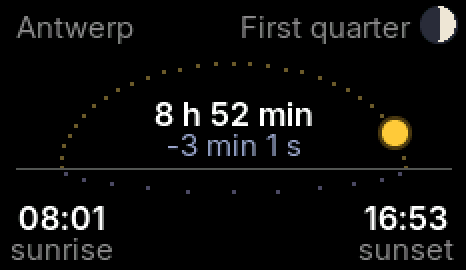</a><br><b><a href="plugins/daylight.lua">Daylight</a></b><br>Sunrise, sunset and the length of the day, how it changed since yesterday, and the moon</td>
<td width="33%" valign="top"><a href="plugins/deploy.lua">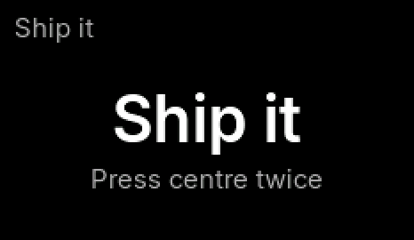</a><br><b><a href="plugins/deploy.lua">Deploy button</a></b><br>Press, confirm, and your deploy hook is called. Shows whether it worked and when it last ran</td>
<td width="33%" valign="top"><a href="plugins/doorbell.lua">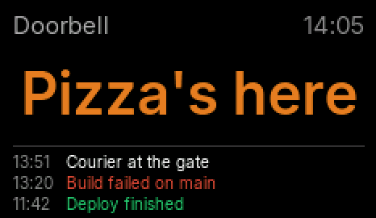</a><br><b><a href="plugins/doorbell.lua">Doorbell</a></b><br>Shows what your scripts send it, at once: the text, the time, a flash of the LED</td>
</tr>
<tr>
<td width="33%" valign="top"><a href="plugins/expiry.lua">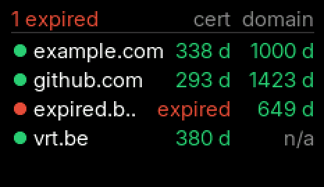</a><br><b><a href="plugins/expiry.lua">Expiry</a></b><br>Days until the certificates and domain names of your sites expire. Orange LED a month ahead</td>
<td width="33%" valign="top"><a href="plugins/flappy.lua">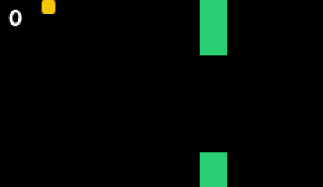</a><br><b><a href="plugins/flappy.lua">Flappy Hog</a></b><br>One button. Endless frustration. Infinite glory.</td>
<td width="33%" valign="top"><a href="plugins/gauge.lua">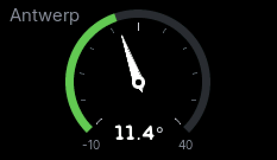</a><br><b><a href="plugins/gauge.lua">Gauge</a></b><br>A round dial for any number from a JSON address, such as a temperature or a sensor</td>
</tr>
<tr>
<td width="33%" valign="top"><a href="plugins/github.lua"></a><br><b><a href="plugins/github.lua">GitHub</a></b><br>Open pull requests and whether the build passes, per repository. Red LED on failure</td>
<td width="33%" valign="top"><a href="plugins/habits.lua">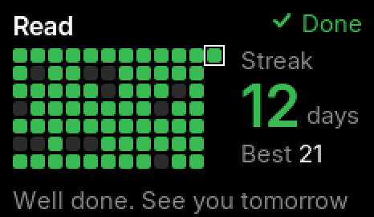</a><br><b><a href="plugins/habits.lua">Habits</a></b><br>Tick off a daily habit and see the last twelve weeks, your streak and your best</td>
<td width="33%" valign="top"><a href="plugins/hackernews.lua">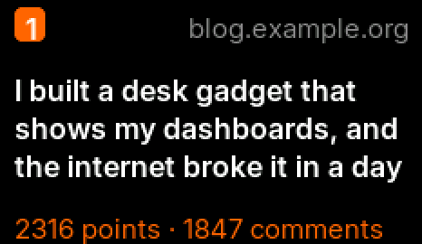</a><br><b><a href="plugins/hackernews.lua">Hacker News</a></b><br>The top stories on Hacker News, one at a time, with points and comments</td>
</tr>
<tr>
<td width="33%" valign="top"><a href="plugins/hello.lua"></a><br><b><a href="plugins/hello.lua">Hello</a></b><br>The smallest useful plugin: three lines of text and a press counter</td>
<td width="33%" valign="top"><a href="plugins/runner.lua"></a><br><b><a href="plugins/runner.lua">Hog run</a></b><br>An endless run: jump the logs, roll under the bees</td>
<td width="33%" valign="top"><a href="plugins/homeassistant.lua">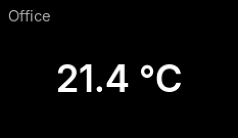</a><br><b><a href="plugins/homeassistant.lua">Home Assistant</a></b><br>A card per entity: its state, and a button to toggle it or run a script or scene</td>
</tr>
<tr>
<td width="33%" valign="top"><a href="plugins/homey.lua">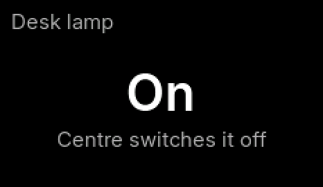</a><br><b><a href="plugins/homey.lua">Homey</a></b><br>A card per Homey Pro device: one of its values, and a button that switches it or starts a flow</td>
<td width="33%" valign="top"><a href="plugins/lander.lua">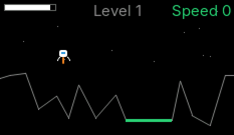</a><br><b><a href="plugins/lander.lua">Lander</a></b><br>Three thrusters, a little fuel and a landing pad that keeps shrinking</td>
<td width="33%" valign="top"><a href="plugins/friend.lua"></a><br><b><a href="plugins/friend.lua">Max</a></b><br>Max the hedgehog keeps you company and thinks you are doing fine</td>
</tr>
<tr>
<td width="33%" valign="top"><a href="plugins/nowplaying.lua">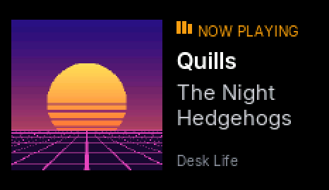</a><br><b><a href="plugins/nowplaying.lua">Now playing</a></b><br>What you are listening to, with the album cover, from Last.fm</td>
<td width="33%" valign="top"><a href="plugins/onthisday.lua"></a><br><b><a href="plugins/onthisday.lua">On this day</a></b><br>Events, births and deaths from Wikipedia that happened on today&#x27;s date</td>
<td width="33%" valign="top"><a href="plugins/paddle.lua">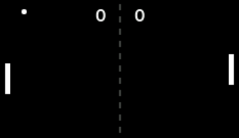</a><br><b><a href="plugins/paddle.lua">Paddle</a></b><br>First to five points beats the hedgehog on the other side</td>
</tr>
<tr>
<td width="33%" valign="top"><a href="plugins/pet.lua">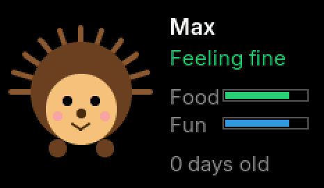</a><br><b><a href="plugins/pet.lua">Pet hedgehog</a></b><br>A hedgehog that gets hungry and bored, sleeps at night and likes a pat</td>
<td width="33%" valign="top"><a href="plugins/planes.lua">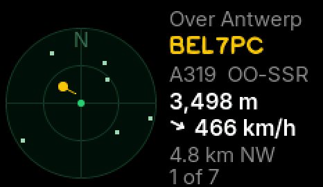</a><br><b><a href="plugins/planes.lua">Planes</a></b><br>The aircraft overhead right now, on a small radar, with callsign, height, speed and type</td>
<td width="33%" valign="top"><a href="plugins/pomodoro.lua"></a><br><b><a href="plugins/pomodoro.lua">Pomodoro</a></b><br>Focus for 25 minutes, take a break, repeat. The LED shows which it is</td>
</tr>
<tr>
<td width="33%" valign="top"><a href="plugins/posthog.lua"></a><br><b><a href="plugins/posthog.lua">PostHog</a></b><br>PostHog insights on your desk: big numbers, line charts and funnels</td>
<td width="33%" valign="top"><a href="plugins/question.lua"></a><br><b><a href="plugins/question.lua">Questions</a></b><br>Icebreaker questions for the minutes before a meeting starts</td>
<td width="33%" valign="top"><a href="plugins/rain.lua">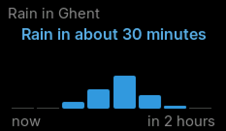</a><br><b><a href="plugins/rain.lua">Rain</a></b><br>Whether it will rain in the next two hours, where you are, quarter by quarter</td>
</tr>
<tr>
<td width="33%" valign="top"><a href="plugins/reaction.lua"></a><br><b><a href="plugins/reaction.lua">Reaction timer</a></b><br>Wait for green, then press. How many milliseconds did you need?</td>
<td width="33%" valign="top"><a href="plugins/releases.lua">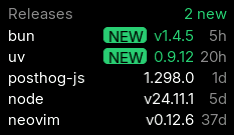</a><br><b><a href="plugins/releases.lua">Release radar</a></b><br>The latest release of the GitHub repositories you follow, with new ones marked</td>
<td width="33%" valign="top"><a href="plugins/reminders.lua">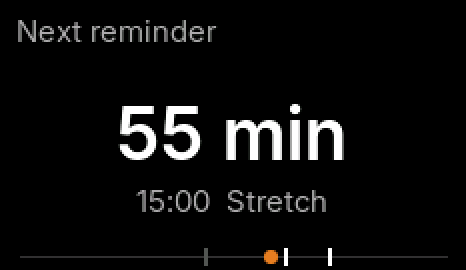</a><br><b><a href="plugins/reminders.lua">Reminders</a></b><br>Daily reminders that come to the front when it is time, with a countdown to the next</td>
</tr>
<tr>
<td width="33%" valign="top"><a href="plugins/rps.lua"></a><br><b><a href="plugins/rps.lua">Rock paper scissors</a></b><br>One button per hand. First to three beats the hedgehog</td>
<td width="33%" valign="top"><a href="plugins/simon.lua"></a><br><b><a href="plugins/simon.lua">Simon</a></b><br>Watch the pattern, repeat the pattern. It gets longer every round</td>
<td width="33%" valign="top"><a href="plugins/snake.lua">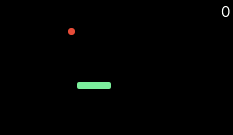</a><br><b><a href="plugins/snake.lua">Snake</a></b><br>Two buttons to steer, one to pause. Eat, grow, don&#x27;t bite yourself</td>
</tr>
<tr>
<td width="33%" valign="top"><a href="plugins/space.lua">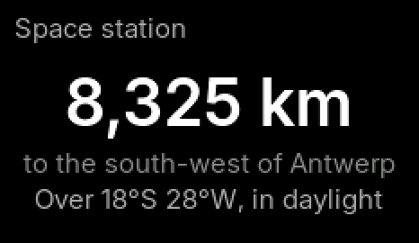</a><br><b><a href="plugins/space.lua">Space</a></b><br>How far away the space station is right now, and a countdown to the next rocket launch</td>
<td width="33%" valign="top"><a href="plugins/starfield.lua"></a><br><b><a href="plugins/starfield.lua">Starfield</a></b><br>Stars flying past, for when the desk needs to look busy</td>
<td width="33%" valign="top"><a href="plugins/status.lua">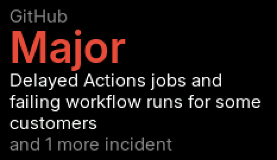</a><br><b><a href="plugins/status.lua">Status board</a></b><br>How the services you depend on are doing, from their status pages. Red LED during an outage</td>
</tr>
<tr>
<td width="33%" valign="top"><a href="plugins/tally.lua">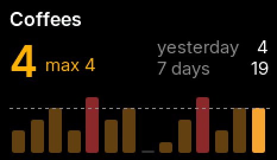</a><br><b><a href="plugins/tally.lua">Tally</a></b><br>Count things through the day, with a goal or a limit and the last two weeks</td>
<td width="33%" valign="top"><a href="plugins/queues.lua">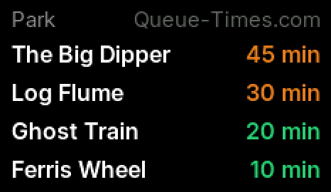</a><br><b><a href="plugins/queues.lua">Theme park queues</a></b><br>The longest waits in a theme park right now, or the rides you care about</td>
<td width="33%" valign="top"><a href="plugins/timers.lua">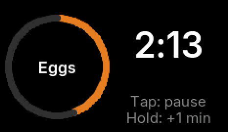</a><br><b><a href="plugins/timers.lua">Timers</a></b><br>Three kitchen timers, one press away. The LED blinks when time is up</td>
</tr>
<tr>
<td width="33%" valign="top"><a href="plugins/trains.lua">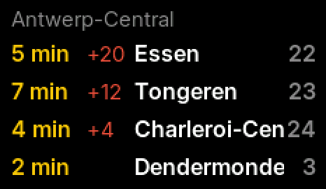</a><br><b><a href="plugins/trains.lua">Trains (Belgium)</a></b><br>The next departures from a Belgian station, with delays and platforms</td>
<td width="33%" valign="top"><a href="plugins/trivia.lua"></a><br><b><a href="plugins/trivia.lua">Trivia</a></b><br>Ten questions, three answers, one button each. From the Open Trivia Database</td>
<td width="33%" valign="top"><a href="plugins/uptime.lua"></a><br><b><a href="plugins/uptime.lua">Uptime</a></b><br>Checks up to five web addresses every two minutes. Red LED when one is down</td>
</tr>
<tr>
<td width="33%" valign="top"><a href="plugins/velo.lua">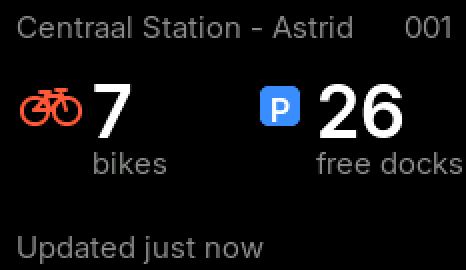</a><br><b><a href="plugins/velo.lua">Velo</a></b><br>Bikes and free docks at your Velo Antwerpen station, or at another bike share&#x27;s</td>
<td width="33%" valign="top"><a href="plugins/weather.lua">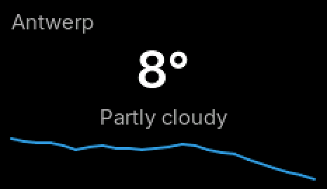</a><br><b><a href="plugins/weather.lua">Weather</a></b><br>The temperature now and today&#x27;s curve, for any number of cities</td>
<td width="33%" valign="top"><a href="plugins/webhook.lua"></a><br><b><a href="plugins/webhook.lua">Webhook</a></b><br>A button that calls a web address and lights the LED</td>
</tr>
<tr>
<td width="33%" valign="top"><a href="plugins/whack.lua">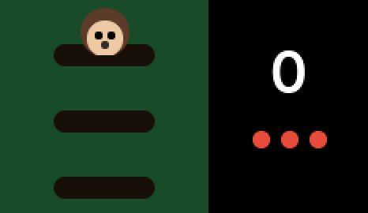</a><br><b><a href="plugins/whack.lua">Whack-a-hog</a></b><br>Three burrows, three buttons. Bonk the hedgehog before it ducks</td>
<td width="33%" valign="top"><a href="plugins/wifi.lua">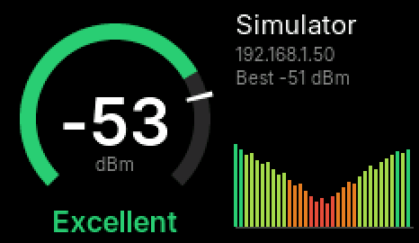</a><br><b><a href="plugins/wifi.lua">WiFi</a></b><br>A signal meter to carry around: strength as a dial, with the last half minute as a chart</td>
<td width="33%" valign="top"><a href="plugins/word.lua">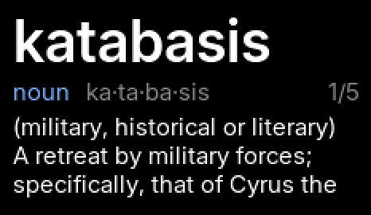</a><br><b><a href="plugins/word.lua">Word of the day</a></b><br>A new word every day, with what it means, from Wiktionary</td>
</tr>
<tr>
<td width="33%" valign="top"><a href="plugins/worldclock.lua">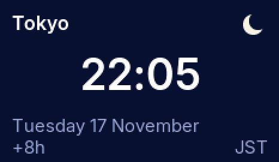</a><br><b><a href="plugins/worldclock.lua">World clock</a></b><br>The time in other cities, a card each, with a sky that shows day or night there</td>
</tr>
</table>
<!-- plugin-list:end -->

PostHog, Home Assistant and Homey Pro need an account or a hub of yours: you fill in its address and a key when you add the first card. The Homey and Home Assistant plugins were written against those systems' documented APIs and tested with sample answers, not yet against real hubs, so expect to report a bug or two.

## Using the device

| | |
|---|---|
| **▲ / ▼** | The previous and the next card |
| **●** | Whatever the card on screen does with it |
| **● held, then ▲** | The previous card, always. Games and other cards may use all three buttons; this is the way out |
| **● + ▼ held for two seconds** | Power off (deep sleep). Press the reset tab on the left to wake it |
| **▼ held while pressing reset** | Bootloader mode, for when the board does not respond and has to be flashed |


The first card is the status card. It is part of the firmware and cannot be removed: it shows the QR code until WiFi is set up, and after that the WiFi status, the device's address, the signal strength and the firmware version.

Plugins update over WiFi and the firmware over USB; see [Updating](#updating).

## Moving from PostHog's firmware

This firmware uses a different flash layout: one firmware slot plus about 1 MB of storage for plugins, where PostHog's has two firmware slots for over-the-air updates. Because of that:

- **The first install has to go over USB.** To keep your WiFi and card settings, install [from source](#from-source): in PlatformIO, choose **Upload** as usual. Installing [from your browser](#from-your-browser) works too, but starts afresh. (Older firmware lost the newest settings on every USB upload, because one boot file was written into the settings area. That is fixed here; see `fix_otadata_offset.py`.)
- **Firmware updates are over USB from now on.** Plugins are what updates over WiFi.
- **Your cards are kept, and ask for their plugin.** The cards that used to be compiled into the firmware (PostHog insights, Max, the question card, Flappy Hog, Paddle, hello world) are plugins now. Cards of those kinds stay in the stack with their settings; until its plugin is installed, a card says so on its screen, and the web page offers to install it with one press.
- **PostHog settings move to a connection.** The project ID and API key that were device-wide settings become the settings of one PostHog connection, which all your insight cards share. Big numbers, line charts and funnels are supported; other kinds of insight are not yet.
- The first boot takes a few seconds longer while the plugin storage is set up.

Going back to PostHog's firmware works the same way, over USB. Use **Erase Flash and Upload** for that, since the layouts differ.

## Working on DeskHog

**On plugins:** the [plugin guide](plugins/README.md) is all you need. Nothing has to be compiled: there is a simulator for your computer and a command line tool that pushes to the device on every save.

**On the firmware:** [tech-details.md](tech-details.md) describes the architecture: the two cores and which task may do what, the card stack, the plugin runtime, the web page and the flash layout. It is a [PlatformIO](https://platformio.org/) project for the Arduino framework, with [LVGL](https://lvgl.io/) for drawing.

Three sets of checks run without a device, and on every push:

```sh
test/native/run.sh          # the plugin runtime, and every plugin in plugins/
test/portal/run.sh          # the web page, against a pretend device
tools/deskhog index --check # the directory's list and the plugin list in this README
```

To work on the web page without flashing, `node test/portal/serve.js` serves it from `html/` against the same pretend device, or against your real one with `--device <address>`.

To flash many boards in one go, see [MULTI_FLASH_GUIDE.md](MULTI_FLASH_GUIDE.md).

### Coding with AI agents

Agents do well on plugins: the API is small, the guide is one file, and `tools/sim/run.sh` gives them a picture of the result to look at. Point your agent at [plugins/README.md](plugins/README.md) and an existing plugin that resembles what you want.

The firmware is harder ground. Models often struggle with multi-threaded embedded code, and DeskHog has strict rules about which task may touch what:

- Give the agent [tech-details.md](tech-details.md) first.
- Cross-core messages go through `EventQueue`; the UI, and with it every plugin, is only touched from the UI task. Flag any suggestion that draws from another task.
- Changes to how cards are created and removed have to be tried on a real device: add and remove a card a few times and watch the serial log. Desktop tests do not catch a dangling LVGL object.

Think of the agent as a speedy junior developer: you are the one keeping it on track.

### What would be welcome

- New plugins, and fixes to the ones that have not met the real service yet (Home Assistant, Homey Pro)
- More kinds of insight in the PostHog plugin ([`plugins/posthog.lua`](plugins/posthog.lua))
- Things plugins cannot do yet: being written to from outside (a push API), QR codes, time zones, sensors on the board's I2C connector, the buttons as USB keys
- Firmware updates without a cable (see the flash layout in [tech-details.md](tech-details.md) for what stands in the way)
- Support for other boards and displays

Open an issue or a pull request on this repository.

## Troubleshooting

### Flashing the board does not seem to change anything

The board can end up booting from the wrong place, for example after switching between this firmware and one with a different flash layout. Choose **Erase Flash and Upload** from the PlatformIO Project Tasks menu. This also erases your WiFi settings, cards and plugins.

### The board does not show up for flashing

Hold ▼, press reset, release ▼. The board restarts in bootloader mode and can be flashed. If the web flasher lists no board at all, try another USB cable: some only carry power.

### After flashing from the browser the screen stays dark

Press the reset tab. The board stays in bootloader mode until it is restarted.

### Get plugins says it cannot reach the plugin directory

The directory is fetched by the computer or phone you are looking at the page with, not by the DeskHog. That device needs internet.

### A card says its plugin is not installed

Open the card on the web page and press Install. This happens after moving from older firmware, and when a plugin was deleted while cards of it remained.

### A card shows an error and a line number

The plugin crashed. Its card says where; the other cards carry on. `tools/deskhog logs <plugin>` and the Plugins page show what it printed before that.

## Credits

DeskHog was created at [PostHog](https://posthog.com) by [Danilo Campos](https://posthog.com/community/profiles/31731), who designed the hardware, the case and the original firmware. Max the hedgehog, the question card and Paddle come from that firmware, and Flappy Hog was built by [Joe Martin](https://posthog.com/community/profiles/29070) at a PostHog hackathon; here they are rewritten as plugins. [The original repository](https://github.com/PostHog/DeskHog) has more games and apps from that hackathon as pull requests, written in C++ for the original firmware.

The Lua plugin system, the plugin directory and the plugins are by [Tim Broddin](https://github.com/TimBroddin).

The code is under the [MIT licence](LICENSE).
