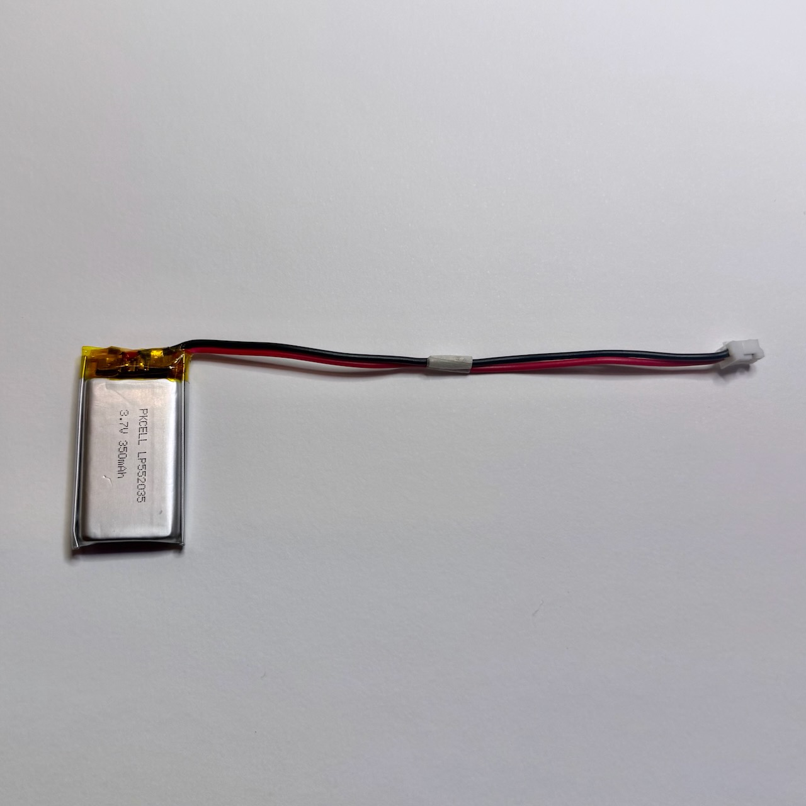
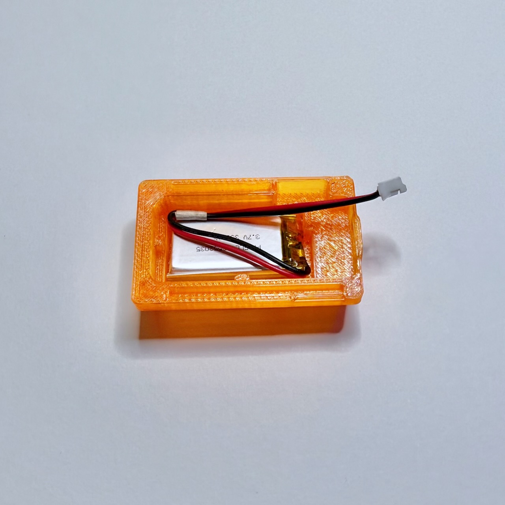
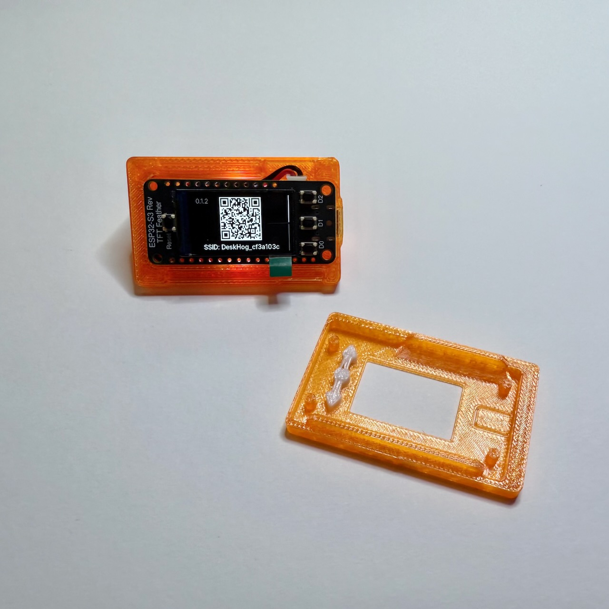

Welcome to the adventure of programmable hardware.

Let’s get you going.

# What's going on?

DeskHog is a palm-sized computer that connects to WiFi. What it shows is a stack of cards, and every card is a plugin: a small Lua file that you install from the device's own web page, or write yourself. The boring stuff is taken care of:

- WiFi setup
- Drawing to the screen
- Moving between cards with the buttons
- A web page to add cards, install plugins and change settings

From here you can pick from the plugins there are, make simple games, connect to web services, or come up with your own adventure.

# Assembly

Whether you received DeskHog as a kit or printed a case yourself, assembly is pretty straightforward. The battery wire will take a moment of finesse.

You’re going to make a sandwich, in this order:

- Base (largest plastic piece)
- Battery
- Board
- Buttons
- Top face (with the PostHog logo)

Stack those pieces together and you’re done.

## Finessing the battery

The battery cable can be a little annoying. Here are tips:

Your battery includes a small piece of tape. Reuse that tape to *bind the battery wires together*. It works best to place the tape at the midpoint of the wires.

Once secured, gently but firmly bend the wires to form a **V** right before the tape, on the side of the battery.

Align the spot on the battery where the wires come out with the small notch cut into the battery well.

From here, attach the battery to the board and attempt to lay the board into its space.

# Dive in

If the board does not have this firmware on it yet, put it there first, over USB: see [Set it up](/README.md#set-it-up).

Once assembled, scan DeskHog's QR code with your phone to open its web page. You can also connect from any computer by choosing the WiFi network shown under the QR code (`DeskHog_…`) from your machine's WiFi menu.

Pick your WiFi network on that page and give its password. From then on the page is at `http://deskhog.local`, or at the address on DeskHog's status card, which is always the first card in the stack.

Now give it something to show: press **Add card** and choose. A new DeskHog has no plugins yet, so the choices come from the plugin directory; choosing one installs its plugin and adds the card. **Get plugins** shows everything there is, with a picture of each.

▲ and ▼ move between cards, and ● belongs to the card on screen. A game may use all three; holding ● and pressing ▲ always takes you to the previous card. Holding ● and ▼ for two seconds turns DeskHog off, and the reset tab on the left wakes it.

Ready to go deeper? A plugin is a few lines of Lua, and you can try it on your computer before it goes on the device: read the [plugin guide](/plugins/README.md). For the firmware itself, whether you're a robot or a human, [tech-details.md](/tech-details.md) will help you get your bearings.
